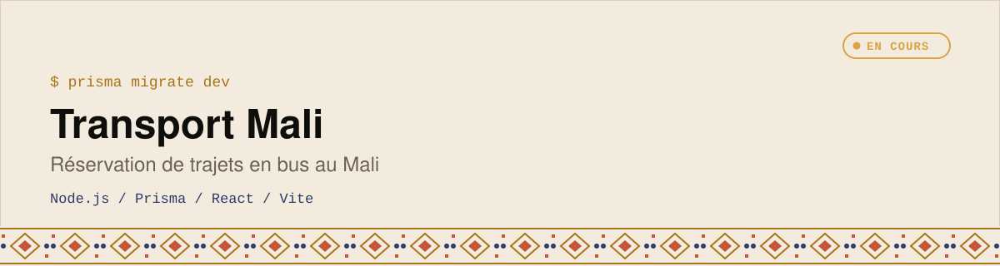
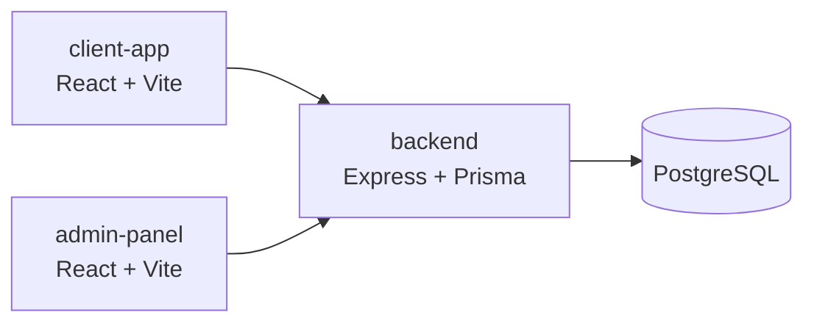

  <picture>
    <source media="(prefers-color-scheme: dark)" srcset="assets/banner-dark.svg">
    
  </picture>

Application de **réservation de transport en bus** pour le Mali : trajets, villes, bus, réservations et paiement.

      

## Architecture

| Dossier | Rôle |
|---|---|
| `backend/` | API Express : authentification, villes, bus, trajets, réservations, paiements (schéma Prisma) |
| `admin-panel/` | Tableau de bord pour gérer trajets, bus et villes |
| `client-app/` | Application client orientée mobile |

## Avancement
D’après [`plan.md`](./plan.md) :
- [x] Backend : schéma Prisma, authentification (JWT + OTP simulé), CRUD villes / bus / trajets
- [x] Panneau d’administration : configuration, design system, gestion trajets / bus / villes
- [ ] Visualisation réelle des réservations dans l’admin
- [ ] Application client : recherche de trajets, choix des sièges, paiement mobile simulé (Orange / Moov)
- [ ] Protection contre la double réservation, ticket avec QR code

*Projet en cours de construction.*

## Licence

Code sous [licence MIT](./LICENSE) · © 2026 Emmanuel Elisé Koné.

---

Construit par **Emmanuel Elisé Koné** ([BinaryMaoGenius](https://github.com/BinaryMaoGenius)) · *La tech en clair*
